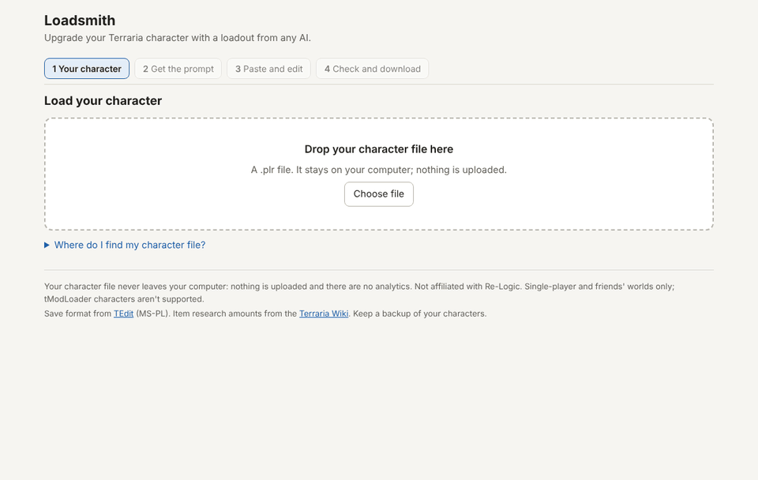

# Loadsmith

Upgrade your Terraria character to the best gear for the current update. Loadsmith gives you a prompt for any AI (ChatGPT, Claude, Gemini), checks the loadout it writes, lets you edit it, and saves an upgraded copy of your character. It runs entirely in your browser: your character file never leaves your computer.

**Use it at [xk3yx.github.io/loadsmith](https://xk3yx.github.io/loadsmith/).**



*A throwaway demo character: "Make my gear perfect" fixes 11 bad modifiers in one click, then the prompt builder for a full AI loadout.*

## How to use it

1. **Close Terraria and back up your character.** Copy your character's `.plr` file somewhere safe, like your desktop (folders are listed below).
2. **Load your character.** Drop the `.plr` file on the page, or click Choose file. Loadsmith shows its name, mode, game version and gear.
3. **Get the prompt.** Pick your class (or all-rounder for three builds), what it's for (bosses or general play) and your world's difficulty, then click Copy prompt.
4. **Ask an AI.** Paste the prompt into ChatGPT, Claude or Gemini. One that can search the web gives the most up-to-date picks. Copy its whole answer.
5. **Paste and check.** Paste the answer into Loadsmith. Anything misspelled or impossible is listed in plain words with "did you mean" buttons, and you can change any item, modifier or amount in the table.
6. **Download.** Look over every change (new items, moved items, new modifiers, anything deleted), then download the new character.
7. **Put it back.** Move the downloaded file into your Players folder, replacing the old one, and start Terraria.

Just want better modifiers? After loading, click **Make my gear perfect**. It gives every weapon and accessory you own its best modifier and changes nothing else. No AI needed.

If your character was last saved in an older Terraria, Loadsmith asks you to load and save it once in the latest game first, so the newest items and modifiers are available.

## Where your characters are

| System | Folder |
| --- | --- |
| Windows | `Documents\My Games\Terraria\Players` |
| Mac | `~/Library/Application Support/Terraria/Players` |
| Linux | `~/.local/share/Terraria/Players` |
| Steam Cloud | `Steam\userdata\<your Steam ID>\105600\remote\players` |

Each character is one `.plr` file named after it. Characters with the cloud icon in the character list are in the Steam Cloud folder.

## Privacy

- Your character file is read and written in your browser. Nothing is uploaded, and there's no server, no account and no analytics.
- The page's security policy blocks it from making any network request at all, so your file can't be sent anywhere even by mistake.
- The prompt you copy holds only your game version, mode, class, goal and world difficulty, never anything from your character.
- The AI's answer is only read and checked, never run.

## What it can and can't do

- Works with Terraria on PC (Steam and GOG, Windows, Mac and Linux), characters saved in 1.4.4.9 through 1.4.5.8.
- Edits gear, inventory, storage (piggy bank, safe, Defender's Forge, Void Vault), the three equipment loadouts, hook, mount and pets, max life and mana, permanent boosters and Journey research.
- Can't change anything stored in the world: bosses defeated, NPC upgrades, the Peddler's Satchel or world difficulty. The AI lists those as things to do in the game.
- Not for mobile or console saves, or tModLoader characters.
- For single-player and friends' worlds. Servers with server-side characters ignore local character files.
- Always saves a new copy. Keep a backup of your original anyway.

## Credits

- The character file format and the item and modifier data come from [TEdit](https://github.com/TEdit/Terraria-Map-Editor) by the TEdit contributors, under the Microsoft Public License (MS-PL). Loadsmith's save code is a port of TEdit's player editor.
- Journey research amounts and the example loadouts' sources come from the [Terraria Wiki](https://terraria.wiki.gg/) ([Journey Mode research](https://terraria.wiki.gg/wiki/Journey_Mode#Research), [Guide:Class setups](https://terraria.wiki.gg/wiki/Guide:Class_setups)). Loadsmith uses facts and links from the wiki, not its text.

## License

Loadsmith is released under the [Microsoft Public License (MS-PL)](LICENSE), the same license as TEdit.

## Not affiliated with Re-Logic

Loadsmith is a fan project. It isn't affiliated with or endorsed by Re-Logic. Terraria is a trademark of Re-Logic. Loadsmith uses no game art: item names only.

## For developers

Vite, React and TypeScript, with zod for validation and Vitest for tests. Node 24 or newer.

```bash
npm ci
```

```bash
npm run dev
```

| Script | What it does |
| --- | --- |
| `npm test` | All tests |
| `npm run typecheck` | TypeScript |
| `npm run lint` | oxlint |
| `npm run build` | Production build in `dist/`, with the security policy |
| `npm run sync-data -- --ref master` | Pulls TEdit's game data (after a Terraria update) |
| `npm run sync-research` | Pulls Journey research amounts from the wiki |
| `npm run check-fixtures` | Checks the test characters CI needs |

**Test characters.** `tests/fixtures/` holds throwaway characters that are committed; CI requires a Classic and a Journey character saved in 1.4.5.8. Personal characters go in `tests/local/`, which is gitignored and never committed; the same tests run on them locally (1.4.4.9 round trips are only checked there).

**Workflows.**

- `ci.yml` runs on every push and pull request, and deploys `main` to GitHub Pages after every check passes. One-time setup: Settings → Pages → Source: GitHub Actions.
- `update.yml` runs every Monday: it syncs TEdit's data, runs the checks, and opens a pull request listing new weapons without a class, modifiers without a rule, renamed items, and changes to TEdit's player save code. One-time setup: Settings → Actions → General → "Allow GitHub Actions to create and approve pull requests".

[PLAN.md](PLAN.md) has the design, the decisions and the checklist to follow after each Terraria update. [docs/save-format.md](docs/save-format.md) describes the `.plr` format. Example loadouts are in [examples/](examples/), and the AI prompt is [prompt/loadout-prompt.md](prompt/loadout-prompt.md).
